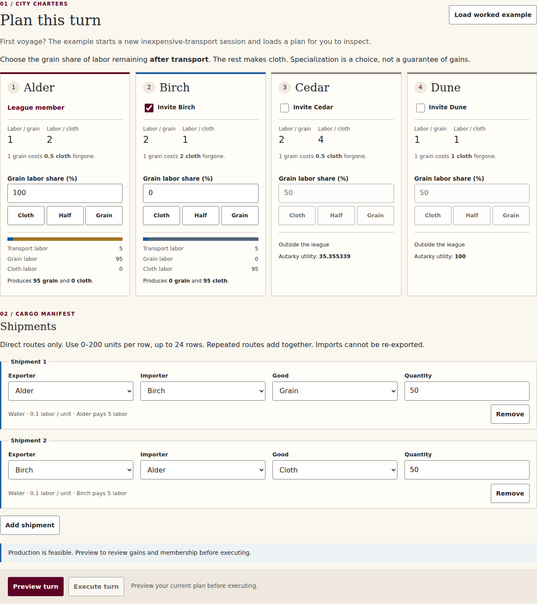
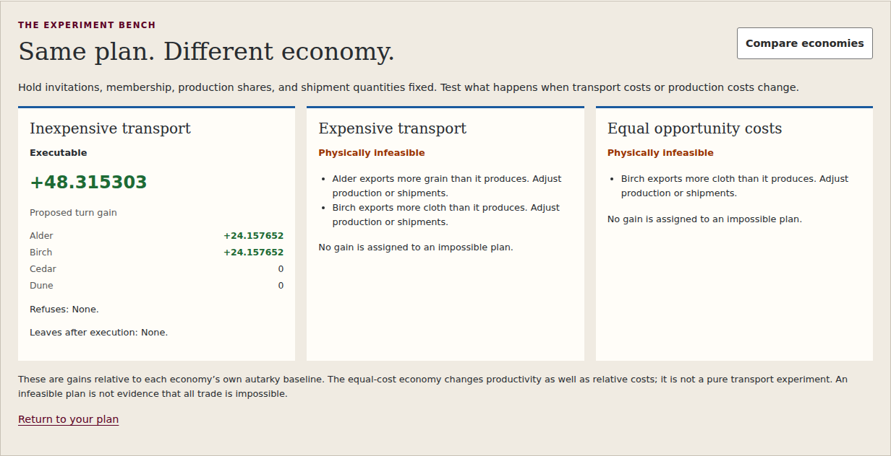
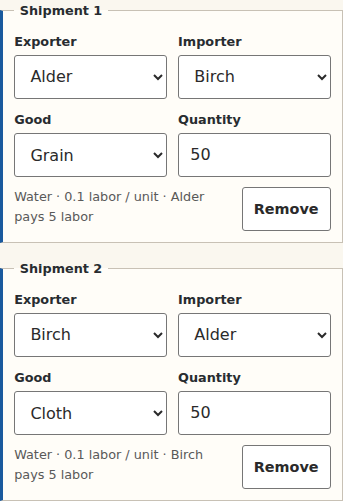

# Proposal: a trading workspace for Hansa

This proposal extends the targeted review changes. It keeps the four fictional
cities, grain and cloth, all three economies, six deterministic turns, cumulative
gains above autarky, exporter-paid transport, no re-exporting, and atomic voluntary
admission. It introduces no optimizer, opponent, random event, historical claim,
backend, telemetry, or automatic persistence. Original economic and development
credits and the local institutional masthead are preserved.

The v1 specification remains the record of the original approved adaptation. This
document records proposed interface and teaching extensions for maintainer review.

## The planning workspace

- Paper, burgundy, grain, and water colors organize a merchant's chart, city
  charters, cargo manifest, council verdict, and league ledger. All decisions still
  use native controls; the chart is a non-geographic schematic.
- City cards place absolute production costs and opportunity cost beside the
  production input. Cloth / Half / Grain presets set grain shares to 0 / 50 / 100;
  exact numeric entry remains available. Presets never execute a turn.
- Each physically valid draft shows transport labor, grain labor, cloth labor,
  and output. The bar is decorative; all quantities also appear as text. These
  values come from `HansaModel.preview`, not a second economic engine.
- Invalid drafts show the model's actual constraints rather than invented outputs.
  Preview still focuses and marks errors. Preview approval is always explicit and
  is cleared by edits, structural changes, or presets.
- The cargo manifest uses labeled fieldsets instead of a wide input table. Each
  shipment shows its direct-route cost and the exporter's transport labor. At
  320px the manifest remains usable without horizontal scrolling.
- The chart highlights pairs with positive planned cargo. It does not imply that
  cargo has executed, that a proposal will be accepted, or that routing through a
  third city is possible.
- Council cards surface each city's gain, utility, baseline, and membership
  decision. Full production, flow, and outcome tables remain available in an
  expandable accounting section.

## A controlled comparison

“Compare economies” evaluates the same invitations, existing membership, shares,
quantities, and current turn in each scenario. It changes neither state nor draft,
never awards points, and cannot substitute for the execution preview. Draft edits
clear the comparison. It is disabled after turn six.

Results distinguish three questions:

1. Is the plan physically possible given labor and own-output limits?
2. Will every newcomer voluntarily accept it?
3. What are individual gains and total gains, and will existing members leave?

Impossible plans have no numerical gain assigned. Refused plans label gains as
hypothetical and keep departures conditional. Every scenario uses its own autarky
baseline. Equal opportunity costs also changes absolute productivity; the UI makes
clear that this is not a one-variable transport experiment. One failed plan does
not establish that all mutually beneficial trade is impossible.

For a controlled transport lesson, load exercise 3 and compare before executing.
Its 50/50 shares and reciprocal 10-unit shipments are physically feasible in both
transport economies, but the cheap exchange benefits both cities whereas the
expensive exchange falls below autarky. In contrast, the 50-unit worked example
becomes physically infeasible in the expensive economy. Both are useful lessons.

## A record students can explain

The six-turn progress indicator distinguishes completed and current turns. The
ledger retains the original history tables, adds discussion prompts, and offers a
CSV download of completed turns. The export includes all four cities, production
shares, labor, production, imports/exports, consumption, utility, baselines,
individual/cumulative gains, membership changes, and total score. Numerical
values retain calculation precision; display rounding is not exported as data.

This is an explicit local download, not autosave, a server upload, or an import
format. Restarting/loading an exercise still clears the current session, as the
controls explain. No student identifiers are collected.

## Architecture and validation

`js/model.js` retains the original economic implementation; its only change from
v1 is the corrected self-check answer wording in the targeted proposal.
`js/learning.js` contains pure scenario comparison and CSV formatting. The
controller owns explicit preview/execution; the view renders local planning aids.
`workspace.css` layers the proposed visual system over the base styles, while the
institutional stylesheet remains untouched. Classic scripts preserve direct
`file://` use and GitHub Pages project-subdirectory hosting.

Validation completed with Node 24 and Chromium 153:

- **345,992** existing model assertions passed.
- **57** learning-tool checks passed: immutability, identical-plan controls,
  independent costly-trade accounting, refusal versus physical infeasibility,
  per-scenario baselines, and full-precision CSV reconciliation.
- **96** browser checks passed across both local-file and HTTP loading: complete
  sessions, all self-checks, invalid-input focus, preview invalidation, comparisons,
  presets, CSV downloads, candidate removal, and responsive layouts.
- Overflow checked at **1280, 640, 375 and 320px**; desktop workspace, comparison,
  and mobile manifest screenshots were visually inspected.
- An axe-core scan of the worked preview and comparison found no automatically
  detected WCAG A/AA violations. Its color-contrast incomplete result still needs
  human review. No accessibility certification is claimed; screen-reader and
  additional-engine testing remain outstanding.

Run `npm ci`, `npx playwright install chromium`, and `npm test` to reproduce the
suites. An existing browser can be selected with `HANSA_CHROMIUM_PATH`. Student
use still requires neither npm nor a build step.

The larger proposal includes the targeted fixes. It can be reviewed and merged
alone, or after the targeted proposal; merging both is not required to get its
fixes. Neither proposal deploys the activity or overrides the maintainer's review
and teaching-release process.
